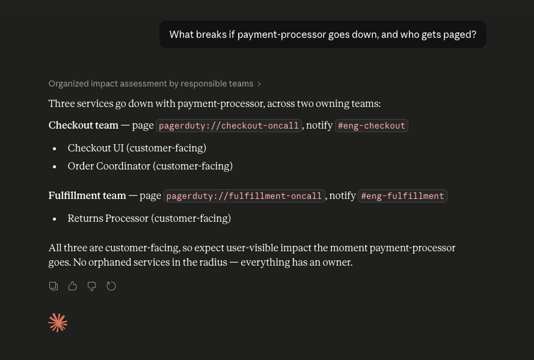
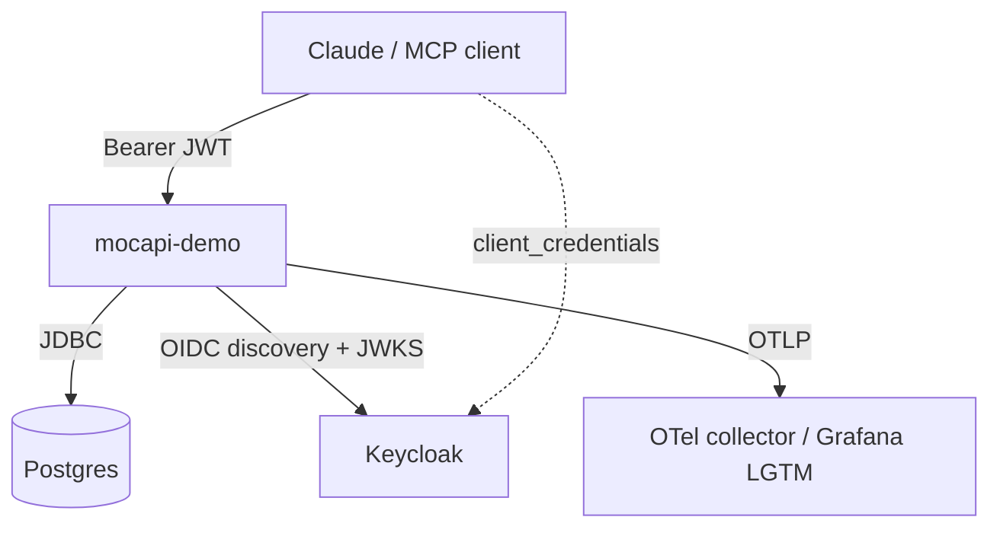
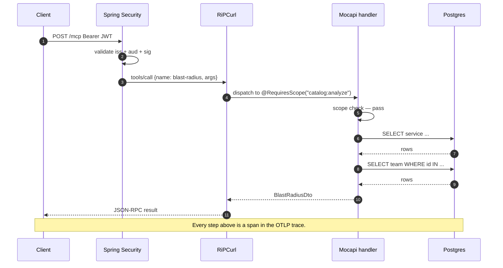

# Mocapi Enterprise Demo

[](LICENSE)
[](https://github.com/callibrity/mocapi-enterprise-demo/pkgs/container/mocapi-enterprise-demo)

[](https://sonarcloud.io/summary/new_code?id=callibrity_mocapi-enterprise-demo)
[](https://sonarcloud.io/summary/new_code?id=callibrity_mocapi-enterprise-demo)
[](https://sonarcloud.io/summary/new_code?id=callibrity_mocapi-enterprise-demo)
[](https://sonarcloud.io/summary/new_code?id=callibrity_mocapi-enterprise-demo)
[](https://sonarcloud.io/summary/new_code?id=callibrity_mocapi-enterprise-demo)

An **enterprise-grade MCP server** built on Spring Boot 4, [Mocapi](https://github.com/callibrity/mocapi), and GraalVM native. Exposes a fictitious service catalog ("Meridian") over the Model Context Protocol so an LLM can answer the kinds of questions every enterprise engineering org struggles with:

- **Who owns this service?** What happens if it breaks?
- **Which services touch PII / PCI?** Are any of them orphaned?
- **What's our deprecation debt?** Which legacy services are still being called, and by whom?
- **If we sunset this team, what are we on the hook for?**

The point isn't the catalog. The point is what sits around it: OAuth2 with RFC 8707 resource indicators, scope-gated tool visibility, three-pillar OpenTelemetry, a stateless request model that scales to any number of replicas without shared session state, native-compilable everything — the patterns real MCP deployments need but toy examples skip.

**How to use this repo.** For *how Mocapi works* — tool dispatch, schema generation, the streamable HTTP transport, bean validation mechanics, MDC correlation, Observation-to-OTel bridging — read the [Mocapi docs](https://github.com/callibrity/mocapi). This repo picks up where those leave off: it shows the **enterprise wrapper** you build around Mocapi when you're taking MCP from a toy to a deployment.

### Start here

This README is long because the demo is thorough. You almost certainly don't need all of it — pick your row:

| If you want to… | Go to | Time |
|---|---|---|
| See it running and call a tool | [Quickstart](#quickstart) | 2 min |
| Add your own tool | [Write your first tool](#write-your-first-tool) | 10 min |
| Understand the production patterns | [Enterprise pillars](#enterprise-pillars) | 15 min |
| Know which Mocapi module does what | [Feature tour](#feature-tour--mocapi) | skim |
| Run the native image | [GraalVM native image](#5-graalvm-native-image) | 1 command |
| Fix something that's broken | [Troubleshooting](#troubleshooting) | — |

The only prerequisites are **Java 25**, **Maven**, and **Docker**. Everything else — Postgres, Keycloak, Grafana, realm import, seed data — is started for you.

---

## Seeing it in action

One natural-language question, and Claude works the catalog the way a human would — only without the tab-hopping:



The user asked in English. The LLM picked the right tools (`blast-radius` plus `team-lookup` for the on-call handles) and came back with a structured answer you could act on — teams to notify, PagerDuty handles to page, Slack channels to loop in, and an orphan check confirming no unowned services in the radius. The same question normally means 20 minutes of digging through Confluence, the service registry, PagerDuty, and Slack; here it's one prompt.

Or harder questions — the kind a compliance audit asks — where the "right answer" isn't in any single system:


Notice the LLM cross-referenced three different tool outputs (tag-filtered listing, orphan detection, blast-radius) and reframed the answer around the *actual* risk — compliance, not availability — with a concrete recommendation. The catalog data is the raw material; the LLM is the analyst.

That's the payoff. The rest of this README is about the enterprise wrapper that makes this safe to run in production: OAuth2 with audience binding so only authorized clients get there, scope-gated tools so different users see different tool rosters, a stateless request model so any replica can serve any request, and full OTLP observability so you can see exactly which tool calls the LLM made for which user.

---

## Quickstart

On a fresh clone, run each block in order:

**1. Run the app.** `spring-boot-docker-compose` starts Postgres, Keycloak (with realm pre-imported), and the Grafana OTel stack from `compose.yaml` on boot and stops them on shutdown — no separate compose step needed.

```bash
mvn spring-boot:run
```

**2. Mint a token as the `oncall` persona:**

```bash
TOKEN=$(curl -sS -X POST http://localhost:8180/realms/mocapi-demo/protocol/openid-connect/token \
  -d 'grant_type=client_credentials&client_id=meridian-oncall&client_secret=meridian-oncall-secret' \
  | jq -r .access_token)
```

**3. Call a tool.** There is no handshake. MCP `2026-07-28` is stateless — every request carries its own protocol version and client capabilities in the `_meta` envelope, and the routing headers (`MCP-Protocol-Version`, `Mcp-Method`, and `Mcp-Name` on `tools/call`) must agree with the body or the server returns `-32020 HeaderMismatch`:

```bash
curl -sS -X POST http://localhost:8080/mcp \
  -H "Authorization: Bearer $TOKEN" \
  -H 'Content-Type: application/json' \
  -H 'Accept: application/json, text/event-stream' \
  -H 'MCP-Protocol-Version: 2026-07-28' \
  -H 'Mcp-Method: tools/call' \
  -H 'Mcp-Name: blast-radius' \
  -d '{"jsonrpc":"2.0","id":1,"method":"tools/call","params":{
        "name":"blast-radius","arguments":{"name":"payment-processor"},
        "_meta":{"io.modelcontextprotocol/protocolVersion":"2026-07-28",
                 "io.modelcontextprotocol/clientCapabilities":{}}}}'
```

**4. Discover what the server supports.** `server/discover` replaces the old `initialize` handshake as the capability probe — but it's optional, not a precondition for calling tools:

```bash
curl -sS -X POST http://localhost:8080/mcp \
  -H "Authorization: Bearer $TOKEN" \
  -H 'Content-Type: application/json' \
  -H 'Accept: application/json, text/event-stream' \
  -H 'MCP-Protocol-Version: 2026-07-28' \
  -H 'Mcp-Method: server/discover' \
  -d '{"jsonrpc":"2.0","id":2,"method":"server/discover","params":{
        "_meta":{"io.modelcontextprotocol/protocolVersion":"2026-07-28",
                 "io.modelcontextprotocol/clientCapabilities":{}}}}'
```

It reports the protocol versions the server accepts, its capabilities, cache directives for the listing endpoints, and — in `_meta.io.modelcontextprotocol/serverInfo` — the server's own identity, which now travels on every successful response rather than only at handshake time.

Swap `meridian-oncall` in step 2 for `meridian-viewer` or `meridian-owner` and re-run `tools/list`: you'll get 4, 10, or 12 tools depending on the token's scopes. That's scope-gated visibility, covered below.

Traces, metrics, and logs all land in Grafana at <http://localhost:3000> (`admin` / `admin`) — Tempo for traces, Prometheus for metrics, Loki for logs, all pre-wired as datasources. Keycloak's admin console (if you want to poke around the realm) is at <http://localhost:8180>, `admin` / `admin`.

---

## Write your first tool

A tool is a public method with an annotation. That's the whole contract — no interface to implement, no registration step, no schema to hand-write.

Add this to any `@Component` (or make a new one) and restart:

```java
@McpTool(name = "coin-flip", title = "Coin Flip", description = "Flips a coin.")
public String coinFlip() {
  return ThreadLocalRandom.current().nextBoolean() ? "heads" : "tails";
}
```

It shows up in `tools/list` immediately. Four things happened without you asking:

1. **The tool was discovered and registered.** Mocapi scans Spring beans for `@McpTool` at startup — you'll see `Registered MCP tool: "coin-flip"` in the log.
2. **An input schema was generated** from the method signature. No parameters here, so it's empty.
3. **An output schema was derived** from the return type. `String` becomes text content; return a record and you get `structuredContent` plus a JSON Schema describing it.
4. **It became visible to every caller**, because nothing gated it. See step 3 below.

### Adding parameters

Parameters become the input schema. Validation annotations are enforced *before* your method runs, and their constraints appear in the schema the LLM sees:

```java
@McpTool(name = "coin-flip", title = "Coin Flip", description = "Flips a coin N times.")
public List<String> coinFlip(
    @Schema(description = "How many times to flip") @Min(1) @Max(10) int times) {
  return IntStream.range(0, times)
      .mapToObj(i -> ThreadLocalRandom.current().nextBoolean() ? "heads" : "tails")
      .toList();
}
```

Send `times: 50` and the call is rejected with a validation error — your method is never entered.

### Gating it by scope

Add `@RequiresScope` and the tool disappears for tokens that lack it — not "returns 403", but is absent from `tools/list` entirely, so the LLM never learns it exists:

```java
@RequiresScope("catalog:analyze")
@McpTool(name = "coin-flip", ...)
```

This is why `meridian-viewer` sees 4 tools and `meridian-owner` sees 12.

### Where descriptions come from

Real tools in this repo use `description = "${tools.catalog.blast-radius.description}"`, resolved from [`application.properties`](src/main/resources/application.properties). Tool descriptions are prompt engineering — they're how the LLM decides *when* to call something — and they get long. Externalizing keeps the Java readable and lets you tune the wording without recompiling.

Compare `CatalogTools.java` (thin, scannable) with the description block in `application.properties` (verbose, deliberately so).

### Where to put it

The demo separates transport from logic: [`CatalogTools`](src/main/java/com/callibrity/mocapi/demo/catalog/mcp/CatalogTools.java) is a thin `@McpTool` adapter that delegates to [`CatalogService`](src/main/java/com/callibrity/mocapi/demo/catalog/service/CatalogService.java), which knows nothing about MCP. Business logic stays testable without a protocol, and a REST adapter over the same service would look symmetrically thin.

For a tool that needs to *ask the user something*, see [interactive tools](#4-interactive-tools--elicitation-without-a-session).

---

## Enterprise pillars

This is the spine of what the demo is trying to show. Each pillar is a pattern enterprises actually need.

### 1. Authorization — OAuth2 + RFC 8707 + scope-gated tool visibility

The `/mcp` endpoint is a Spring Security OAuth2 resource server. Every request carries a JWT; Spring validates signature, issuer, and audience before the MCP handler runs.

Keycloak is the local OIDC provider. Its realm (pre-imported from [`keycloak/mocapi-demo-realm.json`](keycloak/mocapi-demo-realm.json)) defines:

- Three **client scopes** that gate what tools a caller can see and invoke:

  | Scope | Tools unlocked |
  |---|---|
  | `catalog:read` | `service-lookup`, `team-lookup`, `services-list`, `teams-list` |
  | `catalog:analyze` | `blast-radius`, `service-dependencies`, `service-dependents`, `orphaned-services`, `deprecated-in-use` |
  | `feedback:write` | `submit-feedback`, `suggest-tool` |

- Three **personas** (M2M clients) with tiered scope assignments:

  | Persona | Scopes | Tools visible | Real-world analog |
  |---|---|---|---|
  | `meridian-viewer` | `catalog:read` | **4** | Everyday directory user |
  | `meridian-oncall` | `+ catalog:analyze` | **9** | 2am-page responder |
  | `meridian-owner` | `+ feedback:write` | **11** | Catalog maintainer |

Tools are gated by `@RequiresScope("...")` from [`mocapi-spring-security-guards`](https://github.com/callibrity/mocapi/tree/main/mocapi-spring-security-guards). When a caller lacks the required scope, the tool is **hidden from `tools/list`** (not just 403'd on invocation) — the LLM never sees an unusable tool in its schema. Defense in depth: if a client somehow invokes a hidden tool anyway, `@RequiresScope` returns JSON-RPC `-32003 Forbidden`.

**RFC 8707 resource indicators** are supported end-to-end: the audience mapper in Keycloak binds issued tokens to `http://localhost:8080/mcp`, and Spring's resource-server validates the `aud` claim against `spring.security.oauth2.resourceserver.jwt.audiences`. This blocks the token-theft-to-other-resource attacks plain bearer tokens allow.

**Swap to a different IdP** by setting three env vars — no code change, no profile juggling:

```bash
SPRING_SECURITY_OAUTH2_RESOURCESERVER_JWT_ISSUER_URI=https://your-tenant.auth0.com/
SPRING_SECURITY_OAUTH2_RESOURCESERVER_JWT_AUDIENCES=https://mcp.yourcompany.com
SPRING_SECURITY_OAUTH2_RESOURCESERVER_JWT_JWK_SET_URI=https://your-tenant.auth0.com/.well-known/jwks.json
```

### 2. Observability — three pillars via OTLP

Traces, metrics, and logs all leave the app via OTLP. Locally, [`grafana/otel-lgtm`](https://github.com/grafana/docker-otel-lgtm) catches all three on `:4318` — it bundles an OTel Collector with Tempo, Prometheus, Loki, and Grafana in one container. In production, point at the OTel collector of your choice (this app's ACA deployment runs one as a pod sidecar).

- **Traces**: Micrometer Observation → OTel bridge (via `spring-boot-starter-opentelemetry`, transitive through `mocapi-otel`). A single tool call produces a complete flame graph: `http post /mcp` → Spring Security filter chain → `tools/call` (RiPCurl dispatch) → tool span (e.g. `blast-radius`) → JDBC `connection`/`query`/`result-set` spans. N+1 query patterns are visible in the trace, not inferred from logs.
- **Metrics**: Micrometer OTLP meter registry pushes on a 60s cadence. JVM, HTTP, JDBC, Hikari, Mocapi handler metrics all flow.
- **Logs**: Logback → OTel `LogRecord` via `opentelemetry-logback-appender-1.0`, wired at boot by an explicit `OpenTelemetryAppender.install(...)`. MDC keys from `mocapi-logging` (`mcp.client.name`, `mcp.protocol.version`, `mcp.handler.kind`, `mcp.handler.name`, `mcp.handler.class`, `mcp.request.id`) propagate as log attributes with trace/span correlation.

  The appender version is pinned deliberately in [`pom.xml`](pom.xml) and must track the OpenTelemetry core version Spring Boot manages — Boot's BOM wins import ordering, so a newer appender resolves against an older API and dies with `NoSuchMethodError` the first time it tries to log an exception. The pom comment spells out the constraint.

No OTel Java agent. No bytecode instrumentation. Works under GraalVM native without special handling.

**Seeing it.** Grafana is at <http://localhost:3000> (`admin` / `admin`) with all three datasources pre-wired. After running the app and making a few tool calls:

- **Traces** — Explore → Tempo → search `{ name = "blast-radius" }`
- **Metrics** — Explore → Prometheus → try `hikaricp_connections_active` or `http_server_request_duration_seconds_count`
- **Logs** — Explore → Loki → `{service_name="mocapi-demo"}`

A trace, its metrics, and the log lines the handler emitted are all correlated by trace id, so you can pivot between them.

> **Why not Jaeger?** The demo emitted all three signals from the start, but Jaeger only ingests traces — metrics and logs were quietly 404ing every 60 seconds, complete with a stack trace in the app log. The `grafana/otel-lgtm` image accepts all three, so the "three pillars" claim is now something you can verify rather than take on faith. Grafana ships that image for demos and local development, **not** for production.

### 3. Persistence — Postgres for the catalog, and nothing else

One durable store, and that is the point:

- **Catalog schema** (service, team, dependency, service_tag) — Liquibase-managed via [`src/main/resources/db/changelog/`](src/main/resources/db/changelog/). Hibernate runs in `ddl-auto=validate`, so drift between entities and schema fails startup instead of silently mutating the DB.

There is no session store, because MCP `2026-07-28` has no sessions. Every request carries its own protocol version, client info, and capabilities in the `_meta` envelope, so the server holds no per-client state between calls. Earlier versions of this demo ran [`substrate-postgresql`](https://github.com/jwcarman/substrate) to persist Mocapi's session atoms, mailboxes, and journals across restarts, with `LISTEN/NOTIFY` for cross-node fan-out and AES-256-GCM encryption at rest for the payloads. The stateless protocol deleted the requirement outright.

That is a better story than the one it replaces. Scaling out no longer means making session state durable and shareable — it means running more replicas behind a load balancer with nothing to coordinate. Any pod can serve any request; a pod dying loses nothing; there is no encryption-at-rest question for session payloads because there are no session payloads. The only state is the catalog, which is application data.

Cross-call application state, when a tool genuinely needs it, uses the spec's explicit-handle pattern: the server hands the client a handle and the client presents it on the next call. State becomes an explicit part of the protocol rather than an invisible server-side lifetime.

### 4. Interactive tools — elicitation without a session

Statelessness raises an obvious question: if the server remembers nothing between calls, how can a tool *ask the user something* and then continue?

MCP 2026-07-28 answers it with **multi round-trip replay (MRTR)**. `draft-maintenance-comms` is the demo's one interactive tool — it asks when the maintenance window is and whether to include unowned services, then renders a notification list from the blast radius. Each unanswered question unwinds the handler and returns an `input_required` result carrying an opaque, encrypted `requestState` token. The client answers and re-sends the same call; the handler **runs again from the top**, with answered questions returning instantly. Two questions mean three executions of the method.

The state lives in that token, held by the client — so the server still remembers nothing, and any replica can serve any leg of the exchange.

The catch is the part worth internalizing, and it's why [`MaintenanceCommsTools`](src/main/java/com/callibrity/mocapi/demo/catalog/mcp/MaintenanceCommsTools.java) is deliberately read-only up to its last question:

> **Everything before the final `elicit(...)` re-runs on every round trip.** A catalog query there is harmless. A charge, an email, or an INSERT would happen three times.

Verify the whole exchange against a running server — JVM or native — with:

```bash
scripts/verify-elicitation.sh
```

It drives all three legs and asserts both answers survive replay. Since `mocapi.mrtr.secret` defaults to an ephemeral per-process key, every leg must reach the same instance; set it explicitly (see the config table) before running more than one replica.

### 5. GraalVM native image

One command, and **you do not need GraalVM installed**:

```bash
scripts/run-native.sh
```

Buildpacks run the native-image compilation inside a container, so Docker is the only prerequisite. It's the same `spring-boot:build-image` invocation [`release.yml`](.github/workflows/release.yml) uses to publish to GHCR — what you run locally is what ships. The script also brings up the compose stack and joins the app container to its network, since a native image gets none of the dev-time conveniences `mvn spring-boot:run` does.

Measured on an M-series Mac, Docker with 16GB, against the seeded 36-service catalog:

| | |
|---|---|
| **Startup** | **0.25 – 0.32s** |
| Image size | 228 MB |
| Resident, idle | ~125 MB |
| Resident, after 41k requests | ~377 MB |
| Build time | ~1m 50s (plus the first-run builder pull) |

Those are container figures — `docker stats` on the running app, so they include the container's own overhead. Resident memory grows roughly 3× under sustained load and then holds steady; if you need a number for capacity planning, use the loaded one, not the idle one.

Everything else matches the JVM build: same Postgres, OAuth2, OTel, and scope guards — nothing strips out under native. Elicitation replay works identically; verify it against the running container with `scripts/verify-elicitation.sh`.

Reachability hints for Liquibase XSDs and Hibernate's `UUID[]` loader live in [`src/main/resources/META-INF/native-image/`](src/main/resources/META-INF/native-image/). Notably there are **no Mocapi-specific hints** — the library ships its own and needs no configuration from you.

**Gotcha worth naming:** when `@ConfigurationProperties` binds to a **Spring-framework type** (we bind to `CorsConfiguration` from `spring-web`), native-image can't find its setters at build-time because that type isn't designed as a properties POJO and therefore isn't auto-hinted. Boot fails on the first matching property key. Fix is one annotation on the properties class:

```java
@ConfigurationProperties(prefix = "mocapi.demo")
@RegisterReflectionForBinding(CorsConfiguration.class)
@Data
public class MocapiDemoProperties { … }
```

Your own nested types auto-hint; only cross-library types need this. See [`MocapiDemoProperties.java`](src/main/java/com/callibrity/mocapi/demo/config/MocapiDemoProperties.java).

CI builds the native image via Paketo buildpacks (`spring-boot:build-image`) and pushes to GHCR on every tagged release — see [`.github/workflows/release.yml`](.github/workflows/release.yml).

---

## Architecture

### Deployment



### Request flow (single MCP tool call)



---

## Feature tour — Mocapi

The "Enterprise pillars" section above is the elevator pitch. This section is the inventory: for every Mocapi module on our classpath, what it does, the dependency that brings it in, and the exact place in this repo we exercise it.

### `mocapi-streamable-http-spring-boot-starter` — the `/mcp` endpoint

Auto-configures the MCP *streamable HTTP* transport: a single `/mcp` path, **POST only**. `GET` and `DELETE` return `405` — the standalone SSE stream and session termination they used to serve are both gone from the protocol.

Every request carries three routing headers that the transport validates against the JSON-RPC body before dispatch: `MCP-Protocol-Version`, `Mcp-Method`, and — on `tools/call` and `prompts/get` — `Mcp-Name`. A mismatch is rejected with `-32020 HeaderMismatch` rather than dispatched. That lets proxies, gateways, and rate limiters route and authorize on headers alone, without parsing a JSON body.

**What it buys you.** The entire MCP wire protocol — capability advertisement via `server/discover`, `tools/list`, `tools/call`, notifications, progress — dropped in as auto-config. Nothing in this repo implements transport.

**Per-request SSE.** Responses still negotiate `text/event-stream`: a handler that reports progress streams those events on the request's own response, then closes. What's gone is the *standalone* stream — no `GET /mcp`, no `Last-Event-Id` resume, no server-side stream registry to encrypt identities for. Clients must accept both `application/json` and `text/event-stream`, or the request is rejected with `406`.

### `mocapi-oauth2` — OAuth2 resource server + RFC 8707

Auto-configures the `/mcp` endpoint as a Spring Security OAuth2 resource server with RFC 8707 audience binding. Transitively pulls in `spring-boot-starter-oauth2-resource-server`, so we don't declare that ourselves. Also serves [`/.well-known/oauth-protected-resource`](https://datatracker.ietf.org/doc/html/rfc9728) so MCP clients can discover the authorization server without hard-coding it.

**What it buys you.** Signature validation, issuer validation, audience validation, JWKS caching, and the spec-correct discovery metadata — all from three properties:

```properties
spring.security.oauth2.resourceserver.jwt.issuer-uri=http://localhost:8180/realms/mocapi-demo
spring.security.oauth2.resourceserver.jwt.audiences=http://localhost:8080/mcp
spring.security.oauth2.resourceserver.jwt.jwk-set-uri=http://localhost:8180/realms/mocapi-demo/protocol/openid-connect/certs
```

See [`application.properties`](src/main/resources/application.properties). Mocapi 0.10+ auto-derives `mocapi.oauth2.resource` from the configured audience, so there's no second place to update when the audience changes.

### `mocapi-jakarta-validation` — Bean Validation on tool arguments

Plugs Jakarta Bean Validation into tool / prompt / resource handler dispatch. Annotations on `@McpTool` parameters (`@NotBlank`, `@Pattern`, `@Size`, `@Min`, `@Max`, …) are enforced before the handler method runs. Violations in tool handlers surface as `CallToolResult.isError=true` with violation detail in the message content — which is the LLM-self-correction path. Violations in prompt or resource handlers surface as JSON-RPC `-32602` with a structured `{field, message}` list.

**How we use it.** Every tool parameter in [`CatalogTools.java`](src/main/java/com/callibrity/mocapi/demo/catalog/mcp/CatalogTools.java) is constrained:

```java
@RequiresScope("catalog:read")
@McpTool(name = "service-lookup", title = "Service Lookup",
    description = "${tools.catalog.service-lookup.description}")
public ServiceDto serviceLookup(
    @Schema(description = "Short name of the service, e.g. 'payment-processor'")
        @NotBlank @Size(max = 100) @Pattern(regexp = "^[a-z0-9-]+$")
        String name) {
  return catalog.lookupService(name);
}
```

**What it buys you.** Validation lives on the parameter, next to the type — same place the tool schema sees it — so the LLM gets an accurate JSON Schema *and* malformed calls never reach handler code.

### `mocapi-spring-security-guards` — scope-gated tool visibility

Supplies `@RequiresScope` / `@RequiresRole`. The guards hook into Mocapi's schema advertisement path: a tool annotated with `@RequiresScope("catalog:analyze")` is **hidden from `tools/list`** for callers whose token doesn't carry that scope. It never appears in the LLM's tool schema, so the LLM can't try to use it.

Defense-in-depth: if a client somehow invokes a hidden tool anyway (forged request, stale schema), the same annotation is enforced at invocation and returns JSON-RPC `-32003 Forbidden`.

**How we use it.** Tiered scopes across tool classes, e.g.

```java
@RequiresScope("catalog:analyze")
@McpTool(name = "blast-radius", …)
public BlastRadiusDto blastRadius(@NotBlank String name) { … }
```

See the scope / persona / tool-count matrix in the "Enterprise pillars" section for the full mapping.

**What it buys you.** The LLM's tool roster stays a function of the caller's identity — not of hand-authored allow/deny lists maintained elsewhere. Adding a new tool means picking a scope; nothing else to wire.

### `mocapi-logging` — MDC correlation on every handler

Wraps every tool / prompt / resource handler invocation in an SLF4J MDC scope that stamps:

| Key | Value |
|---|---|
| `mcp.client.name` | Client-reported name from the request's `_meta` envelope (absent — `clientInfo` is optional) |
| `mcp.protocol.version` | MCP protocol version the request declared (e.g. `2026-07-28`) |
| `mcp.handler.kind` | `tool` / `prompt` / `resource` / `resource_template` |
| `mcp.handler.name` | Tool/prompt name, or resource URI / resource-template URI template |
| `mcp.handler.class` | Simple name of the (AOP-unwrapped) Java class hosting the handler |
| `mcp.request.id` | JSON-RPC request id for the in-flight call (absent for notifications) |

**How we use it.** [`logback-spring.xml`](src/main/resources/logback-spring.xml) forwards these MDC keys into the OTel logback appender, which turns them into log-record attributes. The result: every log line the handler emits (including user code) is searchable in the logging backend by client, handler kind, or handler name, correlated with the active trace/span ids.

**What it buys you.** "Which call made the LLM hallucinate?" becomes a log query, not a memory archaeology expedition. Without sessions, the correlation key is the trace id rather than a session id — which is the more useful handle anyway, since it spans the whole request including the JDBC work underneath it.

### `mocapi-otel` — Observation wrapper on every handler

Bundles `mocapi-o11y` (which wraps every handler invocation in a Micrometer `Observation`) with Spring Boot 4's `spring-boot-starter-opentelemetry` (which in Spring Boot 4 is the dep that activates `MicrometerTracingAutoConfiguration` and registers the `DefaultTracingObservationHandler` that bridges Observations to OTel spans). The net effect: every tool call is a named span (e.g. `blast-radius`) with its own attributes, nested under the HTTP request span.

Combined with `datasource-micrometer-spring-boot` + `datasource-micrometer-opentelemetry` (both on our classpath — see [`pom.xml`](pom.xml)), every JDBC statement also becomes an OTel span with `db.query.text`, `db.system.name`, `db.operation.name`, and `db.response.returned_rows` attributes. Which means N+1 patterns are visible in Tempo as a fan of query spans under a single handler span.

**What it buys you.** No OTel Java agent, no bytecode instrumentation, no custom `@Traced` annotations. One starter, one observability pipeline, works under GraalVM native.

### `mocapi-actuator` — `/actuator/mcp` inventory endpoint

Adds a read-only Spring Boot Actuator endpoint that enumerates every registered tool, prompt, and resource — names, titles, descriptions, input/output schema digests, scope requirements. Ops can see what a running build exposes without a token or an LLM.

**How we use it.** One-line opt-in in [`application.properties`](src/main/resources/application.properties):

```properties
management.endpoints.web.exposure.include=health,info,mcp
```

**What it buys you.** Deployment verification (`curl /actuator/mcp | jq '.tools[].name'`) and schema-drift detection (diff the digests across builds) without any custom scaffolding.

---

## Configuration

Everything is env-var overridable. Useful ones:

| Variable | Default | Purpose |
|---|---|---|
| `MOCAPI_MRTR_SECRET` | *ephemeral on boot* | AES-256 key (base64, 32 bytes) Mocapi uses to sign/encrypt elicitation `requestState` tokens. Unset is fine here — this demo has no interactive tools — but multi-replica deployments that elicit must share a stable value, or a retry landing on another pod rejects the token |
| `SPRING_SECURITY_OAUTH2_RESOURCESERVER_JWT_ISSUER_URI` | `http://localhost:8180/realms/mocapi-demo` | IdP issuer |
| `SPRING_SECURITY_OAUTH2_RESOURCESERVER_JWT_AUDIENCES` | `http://localhost:8080/mcp` | Expected `aud` claim value |
| `SPRING_SECURITY_OAUTH2_RESOURCESERVER_JWT_JWK_SET_URI` | `<issuer>/protocol/openid-connect/certs` | JWKS endpoint |
| `SPRING_DATASOURCE_URL` | `jdbc:postgresql://localhost:5432/mocapi-demo` | Postgres JDBC URL |
| `SPRING_DATASOURCE_USERNAME` / `_PASSWORD` | `mocapi` / `mocapi-dev` | Postgres creds |
| `MANAGEMENT_OPENTELEMETRY_TRACING_EXPORT_OTLP_ENDPOINT` | `http://localhost:4318/v1/traces` | OTLP trace endpoint |
| `MANAGEMENT_OPENTELEMETRY_METRICS_EXPORT_OTLP_ENDPOINT` | `http://localhost:4318/v1/metrics` | OTLP metrics endpoint |
| `MANAGEMENT_OPENTELEMETRY_LOGGING_EXPORT_OTLP_ENDPOINT` | `http://localhost:4318/v1/logs` | OTLP logs endpoint |
| `MANAGEMENT_TRACING_SAMPLING_PROBABILITY` | `1.0` | Trace sampling (0.0–1.0); dial down in prod |

---

## Project structure

```
src/main/java/com/callibrity/mocapi/demo/
├── MocapiDemoApplication.java          # Spring Boot entry point
├── catalog/
│   ├── domain/                         # JPA entities + enums
│   ├── repository/                     # Spring Data JPA repositories
│   ├── service/                        # transport-agnostic catalog service
│   ├── mcp/CatalogTools.java           # thin @McpTool + @RequiresScope adapter
│   ├── mcp/MaintenanceCommsTools.java  # the interactive tool (elicitation / MRTR replay)
│   ├── dto/                            # MCP-shaped return types
│   └── seed/                           # startup seed data (36 services, 8 teams, 86 deps)
├── feedback/                           # submit-feedback + suggest-tool
├── config/                             # CORS + actuator chain, demo properties
└── infra/
    └── OpenTelemetryAppenderInitializer.java   # wires logback appender to OTel SDK
```

Plus `scripts/verify-elicitation.sh` — drives a full three-leg elicitation round
trip against a running server (JVM or native binary) and asserts the answers
survive replay.

---

## Troubleshooting

Every entry here is something that actually happened while building this demo, not a hypothetical.

**`406 Not Acceptable` — "Client must accept both application/json and text/event-stream"**
The spec requires clients to accept both, because any call may stream progress. Send `-H 'Accept: application/json, text/event-stream'` — both, on every request, even ones you expect to be plain JSON.

**`-32020 HeaderMismatch`**
The routing headers must agree with the JSON-RPC body. `Mcp-Method` must equal `params.method`, and on `tools/call` / `prompts/get`, `Mcp-Name` must equal `params.name`. This is deliberate: gateways can route and authorize without parsing a body. If you're scripting with curl, a shell-quoting slip that merges two `-H` flags produces exactly this error.

**`405 Method Not Allowed` on `GET /mcp`**
Correct and expected. MCP `2026-07-28` is POST-only; the standalone SSE stream is gone. Note you'll see `401` instead if your token is missing — authentication runs before method checks.

**`java.lang.Error: Unresolved compilation problem` at startup, but `mvn verify` passes**
An IDE using the Eclipse JDT language server (VS Code's Java extension, Eclipse itself) compiled into `target/classes` without Lombok's annotation processor, leaving error-stub `.class` files that override Maven's. The giveaway is a bean failing to instantiate for a class that compiles fine on the command line. Run `mvn clean`, and make sure Lombok is enabled in your editor's Java tooling.

**`ClassNotFoundException` for a class you deleted**
`spring-boot:run` reuses `target/classes`, and the resources plugin does not remove files you deleted from `src`. A stale `META-INF/spring.factories` will happily reference a class that no longer exists. Run `mvn clean`.

**Liquibase `ValidationFailedException: N changesets check sum`**
The JVM build and the native image compute different checksums for the same changelog, so a database populated by one is rejected by the other. `scripts/run-native.sh` sidesteps this by giving the native build its own `mocapi-demo-native` database. If you hit it another way, either point at a fresh database or `docker compose down -v` to start clean.

**`Failed to determine a suitable driver class`**
Something is running without datasource settings. `spring-boot-docker-compose` supplies them for `mvn spring-boot:run` only — it's a dev-time feature and does not apply to a native image or a plain `java -jar`. `application.properties` carries defaults matching `compose.yaml`, so this usually means those were overridden or the database name doesn't exist yet.

**`jq: command not found`**
The verification scripts use it. `brew install jq`.

**`native-image is not installed in your JAVA_HOME`**
You don't need it — use `scripts/run-native.sh`, which builds via buildpacks inside a container. If you're deliberately running `mvn -Pnative native:compile` locally, note that jenv/sdkman shims reset `JAVA_HOME` for the `mvn` process, so export `GRAALVM_HOME` explicitly.

**Native build fails with `exit status 137` or "The Native Image build process ran out of memory"**
The buildpack compiles inside a container, so it gets Docker's memory allocation, not your machine's. Docker Desktop's default (often 8GB) is not enough — the build needs **12GB or more**. Raise it in Docker Desktop → Settings → Resources → Memory. `scripts/run-native.sh` checks this before starting and tells you if it's too low.

**Elicitation retry rejected after a restart**
`mocapi.mrtr.secret` defaults to a key generated at startup, so `requestState` tokens die with the process. Set it explicitly for anything longer-lived than a demo, and always for more than one replica.

---

## What's *not* here (intentionally)

This is a demo, not a production deployment. Real deployments also need:

- **HA** — running multiple replicas. The stateless protocol makes this nearly free: any replica can serve any request, so a plain round-robin load balancer is enough and there is no session affinity to configure. The one caveat is `MOCAPI_MRTR_SECRET`, which must be a shared stable value across instances if you ever add an interactive tool.
- **Secret management** — the demo's Keycloak client secrets are in realm JSON. In prod, mint real secrets in KeyVault/Vault and inject as env vars.
- **Rate limiting / quotas** — nothing prevents a misbehaving LLM from exhausting your Postgres connection pool.
- **Prod-grade Keycloak** — the compose Keycloak runs in `start-dev` mode with in-memory H2. Real deployments back it with Postgres and run `start`.
- **Observability budget** — `sampling.probability=1.0` is fine for local; in prod, dial down and use tail-based sampling at the collector.

---

## Contributing

See [CONTRIBUTING.md](CONTRIBUTING.md). Everything about this project is meant to be read as a template, so if you find a pattern that's muddled, open an issue.

## License

Apache 2.0. See [LICENSE](LICENSE).
